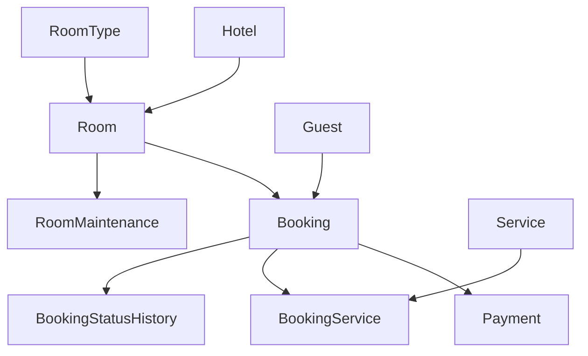
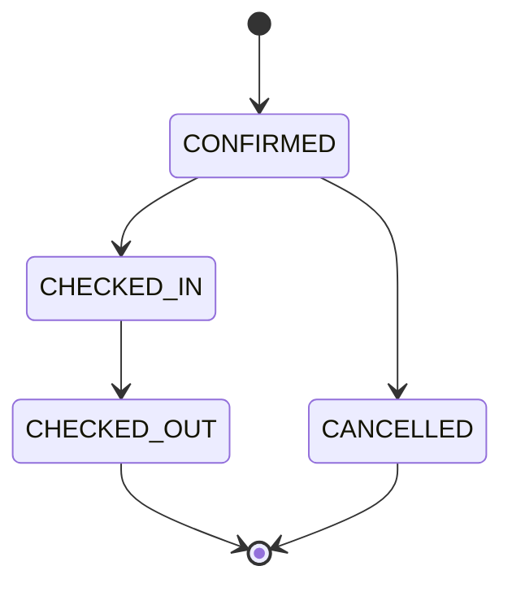

# Hotel Booking Database

A Microsoft SQL Server portfolio project for a small hotel chain: room availability, reservations, guest services, payments, maintenance and operational reporting.

The database is the application core. Business operations are exposed through T-SQL stored procedures; Python provides installation and test tooling. There is no web application or payment gateway.

**Stack:** SQL Server 2022 · T-SQL · Python 3.12 · Docker Compose · GitHub Actions

## What the project demonstrates

- A relational model with 12 tables, primary/foreign keys, checks, filtered uniqueness and workload-oriented indexes.
- Eight public stored procedures with transactions, explicit validation and room-level application locks.
- Protection against overlapping bookings, including concurrent booking and maintenance requests.
- Price snapshots, an append-only payment ledger and idempotent payment references.
- Audited booking status transitions and settlement checks before check-out.
- Five reporting views and an inline table-valued availability function.
- A synthetic dataset with **3 hotels, 36 rooms, 120 guests and 864 bookings** across 2026.
- SQL parsing, runner unit tests, SQL Server integration tests and CI configuration.

## Data model



Arrows run from parent to child through foreign keys. `CalendarDate` expands reservations into room nights for reporting; `SchemaVersion` records the installed baseline. See the [data dictionary](docs/data-dictionary.md).

## Quick start: Docker on Windows

Requirements: Docker Desktop using Linux containers, an x86-64 machine, Python 3.12 and at least 4 GB available to Docker. The container runs the Developer edition for development and testing.

In PowerShell, from the extracted repository directory:

```powershell
py -3.12 -m venv .venv
.\.venv\Scripts\python -m pip install -r requirements-dev.txt
Copy-Item .env.example .env
notepad .env
```

Replace `MSSQL_SA_PASSWORD` with your own strong local password, save the file, then run:

```powershell
docker compose up -d --wait --wait-timeout 180
.\.venv\Scripts\python tools/manage.py init --seed
.\.venv\Scripts\python tools/manage.py status
.\.venv\Scripts\python tools/manage.py report
```

`init` creates `HotelBooking`. It refuses to overwrite an existing database. To create a separate copy:

```powershell
.\.venv\Scripts\python tools/manage.py init --database HotelBookingDemo2 --seed
```

The initial demo is a fictional snapshot as of 19 September 2026. It deliberately includes future reservations and historical stays; it does not move with today's date.

### Linux

```bash
python3 -m venv .venv
.venv/bin/python -m pip install -r requirements-dev.txt
cp .env.example .env
# Edit .env and replace the local password before starting SQL Server.
docker compose up -d --wait --wait-timeout 180
.venv/bin/python tools/manage.py init --seed
.venv/bin/python tools/manage.py status
```

### Connect with SSMS

| Setting | Docker value |
| --- | --- |
| Server name | `localhost,14333` |
| Authentication | SQL Server Authentication |
| Login | `sa` |
| Password | Your local `.env` password |
| Database | `HotelBooking` |
| Trust server certificate | Enabled for this local development container |

Use `sa` only for installation and development. Application access is represented by the `hotel_app` role. For an existing SQL Server installation or Windows Authentication, follow [setup.md](docs/setup.md).

## Try it

Run the following in SSMS with `HotelBooking` selected:

```sql
SELECT *
FROM report.fn_AvailableRooms(1, '20261010', '20261013', 2)
ORDER BY StayAmount, RoomNumber;

SELECT *
FROM report.vDailyHotelPerformance
WHERE HotelID = 1
  AND StayDate >= '20261001'
  AND StayDate < '20261101'
ORDER BY StayDate;
```

Then open:

| File | Demonstration |
| --- | --- |
| [01_booking_lifecycle.sql](examples/01_booking_lifecycle.sql) | Create a guest, reserve a room, check in, add breakfast, pay and check out |
| [02_reports.sql](examples/02_reports.sql) | Availability, occupancy, ADR, RevPAR, guest ranking, cash flow and cancellation rate |
| [03_query_plan.sql](examples/03_query_plan.sql) | Inspect overlap-query reads and execution plan in SSMS |
| [04_reconciliation.sql](examples/04_reconciliation.sql) | Check overlaps, settlement and financial totals |

The lifecycle example writes demo records. Report and reconciliation scripts are read-only. Examples assume the seeded database and an administrator connection.

## Business rules

- One booking reserves one room for one paying guest; adults and children determine capacity.
- Stays use **[check-in, check-out)** dates. A departure and a new arrival can share the same date.
- A stay is 1–365 nights within the calendar range 2020–2040.
- Confirmed, checked-in and checked-out reservations block their scheduled nights. Cancellation releases inventory and waives room charges.
- Check-out requires a zero balance. Cancelling a prepaid reservation leaves a refund due; it does not silently create a refund.
- Services can be posted only while checked in, for a date inside the stay. Their unit prices are copied into the booking service record.
- Captures cannot exceed the bill; refunds cannot exceed net captures. Settled, checked-out bookings cannot be refunded in this model.
- All amounts are PLN. Reports distinguish booked room revenue from money collected.



See [architecture and trade-offs](docs/architecture.md) for lock scope, reporting definitions and deliberate limitations.

## Tests

With the same Python interpreter used during installation:

```powershell
.\.venv\Scripts\python tools/check_sql.py
.\.venv\Scripts\python -m unittest tests.test_unit -v
.\.venv\Scripts\python -m unittest tests.test_integration -v
```

Integration tests require a running SQL Server and an administrative development connection. They create isolated `HotelBookingTest_<random>` databases and remove them afterward. They never reset your `HotelBooking` database. SQL parsing alone is not execution validation.

The GitHub workflow performs these checks against a real SQL Server 2022 container, then runs the documented installation. [Validation notes](docs/validation.md) distinguish checks already run from CI that runs after you push.

## Repository layout

| Path | Purpose |
| --- | --- |
| `sql/001_schema.sql` | Tables, indexes, calendar and audit trigger |
| `sql/002_procedures.sql` | Business operations and internal room-lock helper |
| `sql/003_reporting.sql` | Reporting views and availability function |
| `sql/004_security.sql` | Database roles and baseline version |
| `sql/005_seed.sql` | Synthetic demonstration data |
| `tools/` | Safe installation, status and SQL parser tools |
| `tests/` | Runner, business-rule, permission and concurrency tests |
| `examples/` | Runnable usage and reporting queries |
| `docs/` | Setup, design, API, data dictionary and interview notes |
| `.github/workflows/ci.yml` | Automated SQL Server validation |

## Publish to GitHub

Create an empty repository named `hotel-booking-database` on GitHub, then run from this directory:

```bash
git init -b main
git add .
git commit -m "Add hotel booking SQL Server project"
git remote add origin https://github.com/YOUR_USERNAME/hotel-booking-database.git
git push -u origin main
```

Replace `YOUR_USERNAME`. `.env`, database files and backups are ignored. Suggested repository description:

> SQL Server hotel booking database with transactional reservations, payment ledger, operational analytics and automated integration tests.

Suggested topics: `sql-server`, `tsql`, `database-design`, `hotel-booking`, `data-engineering`, `portfolio`.

## Documentation

[Setup](docs/setup.md) · [Architecture](docs/architecture.md) · [Data dictionary](docs/data-dictionary.md) · [API reference](docs/api.md) · [Validation](docs/validation.md) · [Объяснение для собеседования](docs/interview-ru.md)

## License

[MIT](LICENSE). All demonstration names and contact details are fictional.
